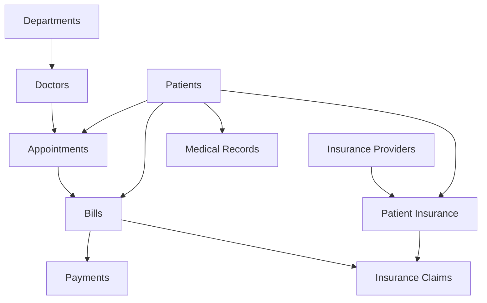

**Healthcare Management System | SQL Server & Power BI**
A portfolio project exploring hospital operations, patient management, appointment scheduling, billing, insurance, data quality, and reporting using Microsoft SQL Server (T-SQL) and Power BI.

The repository combines practical SQL exercises with hospital-management scenarios, reusable database objects, and a Power BI report (HIMS.pbix).
Business problem
Hospital operations involve connected information about patients, doctors, appointments, medical records, bills, payments, insurance, and medication inventory. When these records are not consistently validated and analyzed, teams can struggle to:
- Track appointment activity and doctor availability.
- Identify missing or inconsistent patient information.
- Reconcile billing and insurance-related records.
- Spot orphaned appointments and other referential-integrity issues.
- Monitor medication inventory and overdue or incomplete operational processes.
- Communicate operational trends through understandable reports.
**Project objectives**
1. Query hospital data with SQL to answer patient, appointment, doctor, and billing questions.
2. Practice joins, CTEs, subqueries, window functions, views, temporary tables, and dynamic SQL.
3. Build stored procedures and functions for repeatable processing and business logic.
4. Explore triggers, audit logging, exception handling, and indexing.
5. Apply data-quality checks to identify records needing attention.
6. Present healthcare operations data through Power BI.
Technology stack
Technology	Purpose
Microsoft SQL Server / T-SQL	Data querying and database programming
SQL Server Management Studio (SSMS)	Running and examining SQL scripts
Power BI Desktop	Interactive healthcare reporting
Excel	Reference data dictionaries and a star-schema workbook

**File	Description**
Hosipatel sysytem.sql	Hospital-related SQL queries, joins, aggregations, views, billing examples, inventory analysis, and error-handling examples
Dynamic queries of hosipatel.sql	Insurance sample records and a dynamic appointment-query procedure
Stored Procudures.sql	Data-quality checks and patient information/registration procedure examples
UDF and Triggers.sql	Age calculation, doctor-availability logic, and appointment-history trigger
Indexes.sql	Index and query-plan experimentation, including additional practice examples
HIMS.pbix	Power BI report with Patient Overview and Month Wise pages
Data Dictionary of hosipatel.xlsx	Hospital data dictionary
Data Dictionary of Product.xlsx	Additional reference workbook
hospital_powerbi_star_schema.xlsx	Workbook related to the Power BI star-schema design

Repository note: The supplied archive also contains several netflix_*.csv files, which appear unrelated to the hospital-management use case. Consider removing or separating those files when publishing this portfolio project.
SQL capabilities demonstrated
1. Patient and appointment analysis
- Retrieve and filter patient records.
- Join patients, appointments, doctors, and departments.
- Explore appointment histories, scheduling, and doctor availability.
- Use aggregation and window functions to compare activity over time.
2. Billing and insurance analysis
- Analyze relationships among patients, bills, and payments.
- Explore insurance providers, patient policies, and claims.
- Identify records that require billing or insurance follow-up.
3. Data quality
The USP_dataqualitychecks procedure includes checks for:
- Duplicate patient records.
- Appointments referencing missing patients or doctors.
- Missing patient fields, such as name, date of birth, and phone number.
- Unexpected phone-number lengths.
- Expired medications marked active in inventory.
- Bills with missing appointment relationships.
These checks are examples to review and refine; they are not a claim of a production-validated data-quality framework.
4. Database programmability
- Stored procedures: Encapsulate patient and quality-check operations.
- User-defined functions: Calculate patient ages and support doctor-availability queries.
- Views: Simplify frequently requested patient and insurance information.
- Triggers: Record appointment changes in an appointment-history table.
- Dynamic SQL: Filter appointment data with a parameterized procedure example.
- Indexes: Explore clustered/nonclustered indexing and execution plans.
- Error handling: Demonstrate exception logging in T-SQL.
Power BI dashboard
The included report, HIMS.pbix, has two pages:
- Patient Overview — a patient-focused reporting page.
- Month Wise — a month-oriented reporting page.
The report provides a starting point for communicating operational trends to nontechnical users. Open the PBIX in Power BI Desktop to review visuals, measures, relationships, and data-source settings.
Suggested business KPIs
These are useful metrics for healthcare reporting; their presence and calculated values in the PBIX are not all verified.
KPI	Business meaning
Total Patients	Number of distinct registered patients
Total Appointments	Number of booked appointments
Appointments by Month	Appointment volume trend
Appointment Status Distribution	Counts by appointment status
Doctor Workload	Appointments per doctor
Total Billed Amount	Sum of billed charges
Total Payments	Sum of payments received
Outstanding Balance	Amount still to be collected, based on billing/payment rules
Insurance Claim Status	Claims grouped by approval or processing status
Data Quality Issues	Counts of identified exceptions

**Conceptual data relationships**
The SQL examples reference operational relationships such as:

This is a conceptual operational relationship diagram, not a verified physical schema or a confirmed Power BI star schema. The uploaded star-schema workbook can be used to inspect or refine a dimensional reporting model.
How to explore the project
1. Install SQL Server and SQL Server Management Studio, or use an existing compatible SQL Server environment.
2. Review Data Dictionary of hosipatel.xlsx to understand the tables and fields.
3. Prepare a sample/test Hosipatel_System database with the required base tables and data. The archive is primarily a collection of SQL exercises and does not provide a complete, clean, one-click database setup script.
4. Review and run individual SQL statements from Hosipatel sysytem.sql in a test environment.
5. Run relevant sections of the other SQL scripts only after confirming their table and object dependencies.
6. Open HIMS.pbix in Power BI Desktop; update the data-source connection or credentials as needed.
7. Validate the SQL outputs and Power BI numbers against your test data before sharing screenshots or numerical findings.
Execution warning: Treat the .sql files as learning/development scripts, not an ordered deployment package. Some examples modify tables or data, and Dynamic queries of hosipatel.sql contains a duplicate CREATE TABLE Insurance_Claims block. Review and adjust scripts before executing them. The indexing file also includes examples from an AdventureWorks database, which are separate from the hospital project.

**Potential improvements**
- Package an ordered schema-and-seed deployment script.
- Add constraints, repeatable test data, and automated validation cases.
- Refine the duplicate-detection logic to compare patient business attributes rather than grouping by patient ID.
- Document the actual Power BI relationships and DAX measures.
- Add dashboard screenshots and explain measured results.
- Separate unrelated practice datasets from the healthcare repository.
- Remove or anonymize any real patient information, credentials, or connection details before publication.
Conclusion
This project demonstrates practical experience with SQL Server querying, stored procedures, user-defined functions, triggers, data-quality checks, indexing, and Power BI reporting in a hospital-management context. It highlights how relational data can be explored, validated, and organized to support healthcare operations and analytical decision-making.
